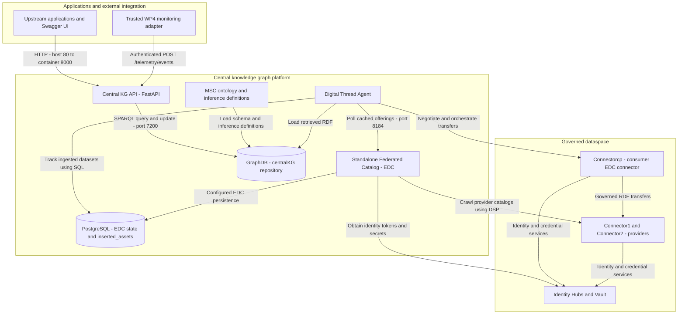
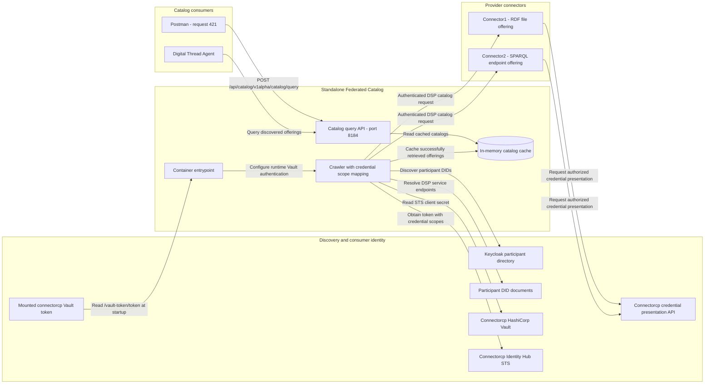

# Central Knowledge Graph (`central-kg`) - Comprehensive Architecture & Development Guide

This document provides a complete technical reference for the **Central Knowledge Graph (CKG)** deployed within the UniMaaS Data Management System (DMS) and Dataspace ecosystem. It details the system architecture, component setup, usage, extension points, and development workflows.

For the recommended documentation path, return to the [documentation index](./README.md). Use the [quick start](./QUICK_START.md) for routine catalog and Digital Thread operation, and the [troubleshooting guide](./TROUBLESHOOTING.md) to resolve common failures.

---

## 1. System Overview & Architecture

The Central Knowledge Graph acts as the semantic backbone of the UniMaaS manufacturing data space. It combines semantic web technologies (RDF/OWL, SPARQL, GraphDB), relational data stores (PostgreSQL), and Eclipse Dataspace Components (EDC) to federate, ingest, reason over, and expose Manufacturing Service Chain (MSC) data.

### 1.1 Architecture Diagram

#### Platform overview

<!-- mermaid-checked: no \n, no em-dash/en-dash, no {} in labels, subgraphs are id["label"], arrows are -->|"label"|, all subgraphs closed by end, ids unique -->


#### Federated catalog discovery and authentication

<!-- mermaid-checked: no \n, no em-dash/en-dash, no {} in labels, subgraphs are id["label"], arrows are -->|"label"|, all subgraphs closed by end, ids unique -->


The catalog query API reads the crawler's cache rather than querying providers
synchronously. Connector1 publishes `request-rdf-service-file`; Connector2
publishes `request-rdf-service-sparql`. With
`UNIMAAS_ENABLE_EXTRA_VP_CATALOGREQUEST=true`, the crawler authorizes both
Membership and DataProcessor credential scopes. Its container entrypoint reads
the current mounted Vault token at startup instead of relying on a copied token.
For routine startup and recovery, use the [quick start](./QUICK_START.md) and
[troubleshooting guide](./TROUBLESHOOTING.md).

For the Infraflex WP4 integration, a trusted WP4 monitoring adapter submits normalized equipment measurements to the Central KG API. The API validates and maps them to RDF before writing to GraphDB. In the governed deployment, EDC remains responsible for publishing, discovery, identity, policy negotiation, and transfer; the telemetry API is the post-transfer ingestion interface, not a replacement for EDC. The monitoring engine and its equipment-specific adapter are external to this repository.

### 1.2 Core Components & Services

| Service Name | Directory / Container | Ports | Description |
| :--- | :--- | :--- | :--- |
| **`central-platform-graphdb`** | `graphdb/` | `7200:7200` | Ontotext GraphDB 10.3.3. Stores RDF triples, evaluates SPARQL queries, loads the MSC ontology, and infers supply chain steps (`sc:hasNextStep`) using an `owl2-rl` ruleset. |
| **`central-platform-postgres`** | `postgres/` | `5432:5432` | PostgreSQL 18 instance. Persists EDC federated catalog records, contract negotiations, transfer processes, and the `inserted_assets` ledger. |
| **`central-platform-kg-api`** | `centralKG_API/` | `80:8000` | Python FastAPI application providing MSC queries, generic SPARQL access, and authenticated Infraflex telemetry ingestion. |
| **`central-platform-federated-catalog`** | Docker image `standalone-federated-catalog` | `8181` (Mgmt), `8184` (Catalog) | Eclipse Dataspace Components (EDC) federated catalog server. Queries dataspace offerings across network participants. |
| **`central-platform-digital-thread`** | Docker image `digital-thread` | Internal daemon | Synchronization agent that periodically retrieves datasets from dataspace connectors, converts/loads them into GraphDB, and registers them in PostgreSQL. |
| **`MSC-Ontology-RDF`** | `MSC-Ontology-RDF/` | Submodule | Git submodule pointing to the official NTUA/FLM Manufacturing Service Chain ontology. |

---

## 2. Prerequisites & Initial Setup

### 2.1 Git Submodules

The repository includes the MSC Ontology repository as a submodule:

```bash
git submodule update --init --recursive
```

### 2.2 Sibling Dependencies (UniMaaS Platform Integration)

As defined in [deploy.sh](./deploy.sh) and [docker-compose.yaml](./docker-compose.yaml), the full multi-service deployment references external configuration files from sibling repositories:

- `../../ed-node/.env-connectorcp` (Dataspace node environment variables)
- `../../ed-node/docker-compose-connectorcp.yml` (EDC connector, Identity Hub, and Vault containers)
- `../deployment/config/demo_dms.json` (Mounted into the Digital Thread Agent)
- `../launchers/digital-thread/postgres/table_creation.sql` (read by the PostgreSQL inserted-assets table helper)

These paths are resolved relative to this repository's root. The deploy wrapper
builds the `standalone-federated-catalog` and `digital-thread` images from the
workspace source when starting those services. The API image is built from
`centralKG_API/Dockerfile`.

---

## 3. Component Setup, Execution & Usage

### 3.1 GraphDB (`central-platform-graphdb`)

#### Configuration

- **Repository Definition**: [graphdb/config/repo-config.ttl](./graphdb/config/repo-config.ttl) sets up repository ID `centralKG` with base URL `http://unimaas-project.eu/kg/` and ruleset `owl2-rl`.
- **Ontology Import**: Automatically imports [MSC-ontology-1.2.0.ttl](./graphdb/config/MSC-ontology-1.2.0.ttl).
- **Infraflex Vocabulary**: [graphdb/config/infraflex-telemetry.ttl](./graphdb/config/infraflex-telemetry.ttl) defines telemetry observations and their relationship to MSC equipment resources. Load it once into an existing repository as described below.
- **Environment**: [graphdb/.env](./graphdb/.env) defines:

  ```ini
  GRAPHDB_URL="http://localhost:7200"
  REPO_ID="centralKG"
  ADMIN_USER="admin"
  ADMIN_PASS="mypassword"
  ```

  
#### Commands

```bash
# Start standalone GraphDB
cd graphdb
docker compose up -d

# Load GraphDB initialization settings into this shell
set -a
source .env
set +a

# Initialize repository and import ontology
./scripts/init-repo.sh

# Load the Infraflex vocabulary into the existing repository
curl -u "$ADMIN_USER:$ADMIN_PASS" \
  -H "Content-Type: text/turtle" \
  --data-binary @config/infraflex-telemetry.ttl \
  "$GRAPHDB_URL/repositories/$REPO_ID/statements"

# Wipe all repository statements (data cleanup)
./scripts/delete_data.sh
```

Run the commands from the `graphdb/` directory after GraphDB is ready and the repository exists. Repository initialization creates the MSC schema; it does not load pilot instance data. Loading the telemetry vocabulary is safe to repeat, but deleting repository data is destructive.

#### Verification & Usage

Access the GraphDB Workbench at:

```text
http://localhost:7200
```

Navigate to **SPARQL**. Note that `init-repo.sh` only loads the schema/ontology (classes and properties), not instance data. To test and observe the inferred `sc:hasNextStep` property:

1. **Insert sample instance triples** (linking two process configurations via an intermediate product):

```sparql
PREFIX sc: <http://unimaas-project.eu/MSCOntology#>

INSERT DATA {
    # Process 1 produces a product
    <http://example.org/pc1> a sc:ProcessConfiguration ;
                             sc:hasOutput <http://example.org/prodA> .

    # Process 2 consumes that same product as input
    <http://example.org/pc2> a sc:ProcessConfiguration ;
                             sc:hasInput <http://example.org/prodA> .
}
```

2. **Query for the inferred `sc:hasNextStep` relationship**:

```sparql
PREFIX  rdf: <http://www.w3.org/1999/02/22-rdf-syntax-ns#> 
PREFIX  xsd: <http://www.w3.org/2001/XMLSchema#> 
PREFIX  rdfs: <http://www.w3.org/2000/01/rdf-schema#> 
PREFIX  owl: <http://www.w3.org/2002/07/owl#> 
PREFIX sc: <http://unimaas-project.eu/MSCOntology#> 

SELECT DISTINCT ?pc1 ?pc2
WHERE
{
    {
      ?pc1 sc:hasNextStep ?pc2.
    }  
} LIMIT 10
```

*Result:* GraphDB's reasoning engine evaluates the property chain `(sc:hasOutput sc:inputOf)` and returns:
`?pc1 = http://example.org/pc1`, `?pc2 = http://example.org/pc2`.

3. **(Optional) Clean up test triples**:

```sparql
PREFIX sc: <http://unimaas-project.eu/MSCOntology#>

DELETE DATA {
    <http://example.org/pc1> a sc:ProcessConfiguration ;
                             sc:hasOutput <http://example.org/prodA> .
    <http://example.org/pc2> a sc:ProcessConfiguration ;
                             sc:hasInput <http://example.org/prodA> .
}
```


---

### 3.2 PostgreSQL (`central-platform-postgres`)

#### Configuration

Environment variables defined in [env/postgres.env](./env/postgres.env):

```ini
POSGRESS_DB=postgrescp
POSTGRES_USER=admin
POSTGRES_PASSWORD=admin
POSTGRES_ADDRESS=jdbc:postgresql://central-platform-postgres:5432/${POSGRESS_DB}
```

#### Commands

```bash
# Start PostgreSQL via deployment script
./deploy.sh up central-platform-postgres

# Create the inserted_assets tracking table
./postgres/scripts/create-inserted-table.sh

# Open interactive psql shell
./postgres/scripts/psql-shell.sh

# Query inserted assets table
./postgres/scripts/query-inserted-assets.sh

# Flush inserted assets records
./postgres/scripts/delete-inserted-assets.sh
```

---

### 3.3 Central KG REST API (`centralKG_API`)

The API wraps the GraphDB SPARQL endpoint with standardized REST routes and custom MSC query handlers.

#### Local Native Development (without Docker)

Install the API dependencies:

```bash
pip install fastapi[all] python-dotenv uvicorn requests pydantic
```

Configure [centralKG_API/api.env](./centralKG_API/api.env):

```ini
DMS_SPARQL_ADDRESS=http://localhost:7200/repositories/centralKG
DMS_SPARQL_UPDATE_ADDRESS=http://localhost:7200/repositories/centralKG/statements
DMS_SPARQL_USER=admin
DMS_SPARQL_PASSWORD=mypassword
DMS_TELEMETRY_API_KEY=<strong secret>
DMS_TELEMETRY_NAMESPACE=http://data.local/graph/infraflex
```

The API query endpoint and update endpoint are separate: existing read routes use `DMS_SPARQL_ADDRESS`; telemetry writes use `DMS_SPARQL_UPDATE_ADDRESS`. Inside Compose, use `http://central-platform-graphdb:7200/...` for both. Set the API key to the same secret used by the trusted telemetry adapter.

From `centralKG_API/`, run the development server with live reload:

```bash
cd centralKG_API
uvicorn main:app --host 0.0.0.0 --port 8000 --reload
```

#### Docker Deployment

```bash
cd centralKG_API
docker build -t centralkg-api:latest .
cd ..
./deploy.sh up central-platform-kg-api
```

The build context must include both `main.py` and `telemetry_rdf.py`; the Dockerfile copies both modules. The helper script `scripts/build-image.sh` removes an existing local `centralkg-api` image before rebuilding it, so use the direct build command above if you need to preserve an existing image tag.

#### API Endpoints Reference

| Method | Endpoint | Description |
| :--- | :--- | :--- |
| `GET` | `/` | Health check endpoint returning `{"message": "Central KG API running"}`. |
| `GET` | `/classes` | Returns all distinct `?class` URIs in the knowledge graph. |
| `GET` | `/instances?class_uri={URI}` | Returns all distinct instances typed as `{class_uri}`. |
| `GET` | `/properties?class_uri={URI}` | Returns all distinct predicates associated with instances of `{class_uri}`. |
| `GET` | `/instance?instance_uri={URI}` | Returns all properties and values for a given instance URI. |
| `GET` | `/instances/by-property?class_uri={C}&property_uri={P}` | Returns instances belonging to class `C` that possess property `P`. |
| `GET` | `/instances/by-property-value?class_uri={C}&property_uri={P}&value={V}` | Filters instances by specific property value (literal or URI). |
| `POST` | `/sparql` | Executes a raw SPARQL query passed in `{ "query": "..." }`. |
| `POST` | `/telemetry/events` | Authenticates with `X-API-Key`, validates an Infraflex batch, and writes timestamped equipment observations to GraphDB. |
| `GET` | `/msc/get_stage?product_uri={URI}` | Returns immediate process configuration, processes, sites, resource configs, suppliers, input products, and output products for a product. |
| `GET` | `/msc/get_all_stages?product_uri={URI}` | Recursively traverses the full supply chain using `(sc:hasNextStep\|^sc:hasNextStep)*`. |

Interactive Swagger documentation is available at `http://localhost/docs` with the root Compose port mapping (`80:8000`), or at `http://localhost:8000/docs` when running the API natively or exposing port 8000 directly.

### Infraflex telemetry contract

The endpoint accepts a JSON object with an `events` array containing 1 to 500 measurements. Each event requires a unique `event_id` within its `source_id`, an `asset_id`, `source_id`, `metric_name`, numeric `value`, and timezone-aware ISO-8601 `observed_at`; `unit` is optional. Event, asset, and source identifiers are bounded strings. Non-finite values, blank identifiers, timezone-naive timestamps, and duplicate `(source_id, event_id)` pairs within one batch are rejected.

```json
{
  "events": [
    {
      "event_id": "evt-001",
      "asset_id": "cell-1-robot-2",
      "source_id": "infraflex-edge",
      "metric_name": "motor_temperature",
      "value": 62.4,
      "unit": "degC",
      "observed_at": "2026-10-21T10:30:00Z"
    }
  ]
}
```

Example call against the root Compose deployment (host port `80`):

```bash
export DMS_TELEMETRY_API_KEY='<the configured API key>'
curl -X POST http://localhost/telemetry/events \
  -H "Content-Type: application/json" \
  -H "X-API-Key: $DMS_TELEMETRY_API_KEY" \
  -d '{"events":[{"event_id":"evt-001","asset_id":"cell-1-robot-2","source_id":"infraflex-edge","metric_name":"motor_temperature","value":62.4,"unit":"degC","observed_at":"2026-10-21T10:30:00Z"}]}'
```

A successful request returns HTTP `202`, the accepted count, and the observation IRIs. An incorrect key returns `401`; invalid payloads return `422`; missing configuration returns `503`; and a GraphDB write failure returns `502`. Exact retries use the same RDF resource and RDF set semantics prevent identical triples from multiplying. Reusing an event identity with changed measurement data can leave multiple values in GraphDB; event identifiers should therefore be immutable, and corrections should use a new event ID unless an explicit replacement policy is added.

Observations use the `http://unimaas-project.eu/InfraflexTelemetry#` vocabulary. Each one is linked through `ifx:observedAsset` to an MSC `sc:EquipmentResource`; assets and observations receive stable IRIs under `DMS_TELEMETRY_NAMESPACE`. A basic GraphDB query is:

```sparql
PREFIX ifx: <http://unimaas-project.eu/InfraflexTelemetry#>
SELECT ?asset ?metric ?value ?unit ?observedAt
WHERE {
  ?observation a ifx:TelemetryObservation ;
    ifx:observedAsset ?asset ;
    ifx:metricName ?metric ;
    ifx:numericValue ?value ;
    ifx:unit ?unit ;
    ifx:observedAt ?observedAt .
}
ORDER BY DESC(?observedAt)
```

Run the API tests from `centralKG_API/` with `python -m unittest discover -s tests`. The API tests need the same FastAPI dependencies as the service; the standard Docker image includes them.

---

### 3.4 Standalone Federated Catalog & Digital Thread Agent

#### Federated Catalog

- Configured in [env/standalone-catalog.env](./env/standalone-catalog.env).
- Manages participant identities (`did:web:edc-proxy-connectorcp:connectorcp`), STS OAuth tokens, HashiCorp Vault secrets, and protocol endpoints (`/api/dsp`, `/api/catalog`, `/api/management`).
- Backed by PostgreSQL schemas automatically generated via `edc.sql.schema.autocreate=true`.

#### Digital Thread Agent

- Configured in [env/digital_thread.env](./env/digital_thread.env).
- Connects to:
  - Catalog: `http://central-platform-federated-catalog:8184/api/catalog`
  - EDC Consumer Management: `http://edc-connector-connectorcp:8081/api/management`
  - GraphDB SPARQL statements: `http://central-platform-graphdb:7200/repositories/centralKG/statements`
  - PostgreSQL asset table: `inserted_assets`
- Runs continuously on an orchestrator loop (`ORCHESTRATOR_DELAY_SECONDS=60`) to ingest new datasets into the knowledge graph.

---

## 4. Run the platform

Use the [quick start](./QUICK_START.md) for the operator workflow to start and
verify the federated catalog and Digital Thread. The provider and consumer
connectors are started separately; follow the
[ED-Node startup guide](../../ed-node/README.md).

The quick start assumes the central `centralKG` GraphDB repository and
PostgreSQL `inserted_assets` table have been initialized. For first-time
initialization and per-component setup, use Section 3 above. Avoid deleting
database volumes during routine shutdown.

---

## 5. How to Extend and Develop

### 5.1 Extending the MSC Ontology & Reasoning

#### 1. Updating Domain Concepts

To add or modify classes and properties:

- Modify [graphdb/config/MSC-ontology-1.2.0.ttl](./graphdb/config/MSC-ontology-1.2.0.ttl) or update the upstream repository via [MSC-Ontology-RDF/](./MSC-Ontology-RDF).
- Classes align with Industrial Ontologies Foundry (IOF) Core (`iof-constr:MaterialProduct`, `iof-constr:RequirementSpecification`).

#### 2. Adding OWL Property Chains

In [graphdb/config/next-steps.ttl](./graphdb/config/next-steps.ttl), OWL property chains infer cross-process links:

```turtle
sc:inputOf   owl:inverseOf sc:hasInput .
sc:outputOf  owl:inverseOf sc:hasOutput .

sc:hasNextStep owl:propertyChainAxiom (
    sc:hasOutput
    sc:inputOf
) .
```

You can declare additional property chain axioms (for example, transitive supplier hierarchies or multi-site process sequences) by appending rules in this file.

#### 3. Custom Ontotext Rule Sets

If OWL2-RL inference is insufficient, Ontotext GraphDB custom forward-chaining rules can be injected via SPARQL Update statements (see [graphdb/scripts/to-evaluate/create_inference_rule.sh](./graphdb/scripts/to-evaluate/create_inference_rule.sh)):

```sparql
PREFIX sys: <http://www.ontotext.com/owlim/system#>
INSERT DATA {
  <_:unimaas> sys:addRuleset '''
  Prefices{
    sc: http://unimaas-project.eu/MSCOntology#
  }
  Rules{
    Id: unimaas_chain
    pc1 <sc:hasOutput> product
    pc2 <sc:hasInput>  product
    --------------------------------------
    pc1 <sc:hasNextStep> pc2
  }
  '''
}
```

---

### 5.2 Extending the Central KG API (`centralKG_API`)

#### 1. Adding New Endpoints

Edit [centralKG_API/main.py](./centralKG_API/main.py) to add domain-specific queries. The `run_sparql(query)` helper manages HTTP timeouts, authentication, and prefix inclusion:

```python
@app.get("/msc/supplier_products")
def get_supplier_products(supplier_uri: str):
    """
    Returns all products associated with a specific supplier URI.
    """
    supplier_uri = urllib.parse.unquote(supplier_uri)
    query = f"""
    PREFIX sc: <http://unimaas-project.eu/MSCOntology#>
    SELECT DISTINCT ?product ?processConfig
    WHERE {{
        ?resource sc:isProvidedBy <{supplier_uri}> .
        ?processConfig sc:usesResource ?resource ;
                       sc:hasOutput ?product .
    }}
    """
    results = run_sparql(query)
    return {
        "supplier": supplier_uri,
        "products": [b["product"]["value"] for b in results["results"]["bindings"]]
    }
```

#### 2. Keeping OpenAPI Docs Synced

FastAPI automatically publishes documentation at `/docs` and updates OpenAPI specs at `/openapi.json`. When modifying endpoints or payloads:

1. Start the API.
2. Fetch the updated spec: `curl http://localhost/openapi.json > docs/openapi.json` with the root Compose port mapping, or use port `8000` for a native/API-only deployment.
3. Commit the updated [docs/openapi.json](./docs/openapi.json).

---

### 5.3 Extending PostgreSQL & Ingestion Pipelines

#### Schema Migrations

The Digital Thread records ingested assets into the `inserted_assets` table. To capture additional lineage metadata (e.g., checksums, provider DIDs, ingestion timestamps):

1. Create a migration script under `postgres/scripts/` (e.g., `add-columns-to-inserted-table.sh`).
2. Update the Digital Thread environment variables in [env/digital_thread.env](./env/digital_thread.env) if table names or connection strings change.

---

## 6. Troubleshooting and security

For symptom-based diagnosis and recovery, use the
[troubleshooting guide](./TROUBLESHOOTING.md). It covers catalog discovery,
negotiation, transfer, GraphDB, and telemetry/API failures.

The telemetry API key is a pilot-level shared-secret gate, not full IAM. Before
exposing services beyond a trusted test environment, use TLS, restrict network
access, rotate development credentials, keep secrets out of version control,
and protect raw SPARQL and GraphDB/PostgreSQL management interfaces.
